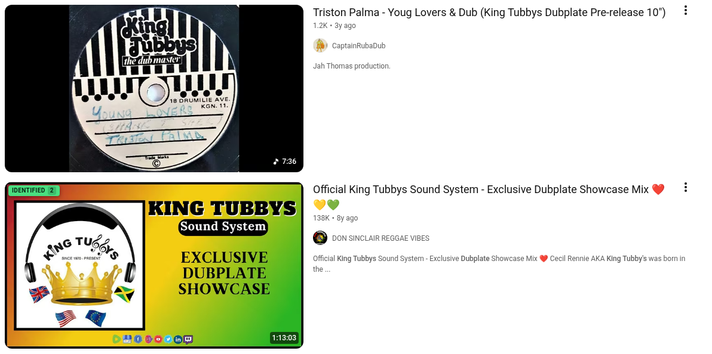
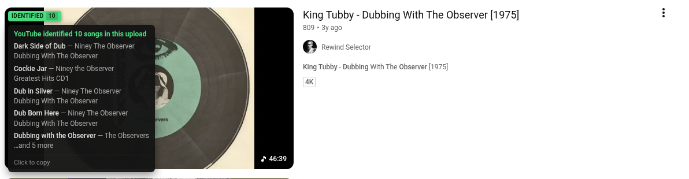
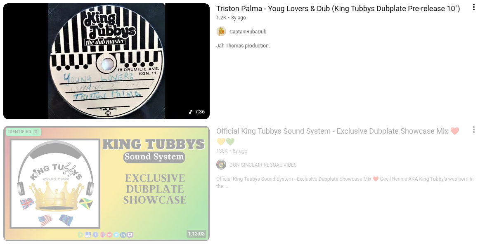
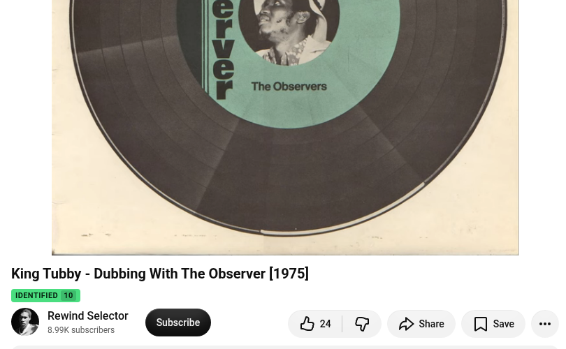
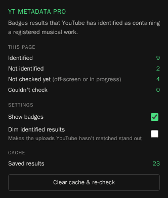
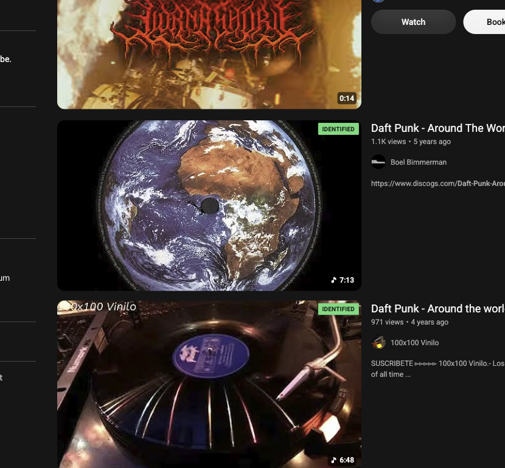

<p align="center">
  <a href="https://github.com/dangercharlie/YT-Metadata-Pro"></a>
  <a href="https://github.com/dangercharlie/YT-Metadata-Pro/releases/latest"></a>
  <a href="https://github.com/dangercharlie/YT-Metadata-Pro"></a>
  <br/>
  <a href="https://github.com/dangercharlie/YT-Metadata-Pro/actions/workflows/validate-extension.yml"></a>
  <a href="https://github.com/dangercharlie/YT-Metadata-Pro"></a>
  <a href="https://github.com/dangercharlie/YT-Metadata-Pro"></a>
  <a href="https://github.com/dangercharlie/YT-Metadata-Pro"></a>
</p>

# YT Metadata Pro

**YT Metadata Pro** is a lightweight Chrome extension that saves you from opening every
YouTube result just to find out whether YouTube has already identified the music in it.

It badges YouTube results — search, home feed and watch-page sidebar — and the video you're
watching with a green **IDENTIFIED** label whenever YouTube's own metadata shows the upload
has been matched to a registered musical work. That includes re-uploads, vinyl rips and
remixes mixed in with already-identified results.

<p align="center">
  
</p>

<p align="center">
  <em>Live capture: a King Tubby's pre-release dubplate YouTube hasn't matched, above a dubplate showcase it has.</em>
</p>

---

## Why?

If you upload or curate music on YouTube, the question that matters is not "is this labelled
as music?" but:

> Has YouTube already identified this recording as a registered work?

Official releases are usually matched. The interesting cases are the ones that are *not* —
a vinyl pressing, a 12" B-side, a dub, a remix — sitting in the same results list as the
official version. This extension puts that answer on the thumbnail so you can see it before
you click.

---

## What It Does

- Badges search results, the home feed and the watch-page sidebar with a green **IDENTIFIED**
  label when YouTube's own page data carries a **music / song-credits section** for the upload
- Also badges the video you're watching, under its title
- Hover a badge to see every matched song — title, artist, album and writers; click it to copy
  `Artist – Song` to the clipboard
- **Dim identified results** (popup toggle) so the uploads YouTube *hasn't* matched stand out
- Popup shows what's been found on the current page, and lets you turn badges off or clear the cache
- Works in any YouTube display language
- Caches results locally so repeat lookups are rare
- Requires **no API key** and **no account**

<p align="center">
  
  <br/><em>Hover a badge to see what YouTube matched; click to copy it.</em>
</p>

<p align="center">
  
  <br/><em>Dim identified results: the uploads YouTube hasn't matched stand out.</em>
</p>

<p align="center">
  
  &nbsp;
  
  <br/><em>The watch page badge, and the popup with counts for the current page.</em>
</p>

---

## How it works

YouTube already knows which uploads contain music it has identified as a registered work —
it just buries that answer in a panel you only see after opening the video. This extension
surfaces it on the thumbnail instead. It doesn't read Content ID data directly — that is only
available to YouTube's partners — it reads what YouTube already shows on the page.

When a result scrolls into view, the extension asks YouTube's own page data whether that
upload has a **Music** section in its description — the list of songs with a "Song credits"
dialog that YouTube shows once it has matched the audio. If it does, the thumbnail gets a green
**IDENTIFIED** badge (with a count when there are several songs), and hovering it lists them.

One detail worth knowing: **it matches recordings, not songs.** The official release of a
track is often identified while a vinyl pressing, B-side, dub or remix of the *same song* is
not. In practice that is usually the distinction worth knowing — and it is why this exists.

<p align="center">
  
  <br/><em>An earlier capture (2.0.0 build): two vinyl rips of the same Daft Punk track, both matched by YouTube.</em>
</p>

Results are cached locally, and lookups are limited to videos on (or about to scroll onto)
the screen.

---

## A note on previous versions

It took a few attempts to get this right.

- **v1.0.0** (retired) used the YouTube Data API field `licensedContent`, which turned out to
  mean *"uploaded by a partner channel"*, not *"this audio was identified"*. Measured across
  499 videos, it fired on 66% non-music content and missed 86% of vinyl rips — and it needed
  every user to supply their own API key.
- **v2.0.0** read the right signal, YouTube's own song-credits panel, but matched it on English
  wording. In any other display language it found nothing, it retried failed lookups forever,
  and it slowed YouTube down as its cache grew.
- **v2.1.0** (current) reads the structure of YouTube's response rather than its wording, and
  was checked end to end against live YouTube — search, home, watch page, in-page navigation,
  popup — before release. Details are in the [CHANGELOG](CHANGELOG.md).

Earlier versions stay browsable at their tags (e.g.
[`v1.0.0`](https://github.com/dangercharlie/YT-Metadata-Pro/tree/v1.0.0)) for reference only.
**Don't install them** — their READMEs predate the fixes above.

**What's least proven.** Testing ran signed out, from one region, in Chrome, with the live
browser in English (the parser itself was checked against responses in six languages). The
areas most likely to still have problems:

- **Page layouts.** YouTube serves different markup to different accounts and experiments. If
  your results use markup the extension doesn't recognise, nothing is badged — it fails quietly
  rather than guessing.
- **Untested setups.** Signed-in accounts, YouTube Premium, EU consent prompts, and other
  Chromium browsers (Edge, Brave) haven't been tried.
- **Rate limiting.** The five-minute pause after repeated failures hasn't been triggered in
  testing.

If badges don't appear for you, the popup's **This page** counts and the `[YT-Metadata-Pro]`
console logs show what the extension is seeing — an issue report with those is the most useful
kind.

---

## Installation

This extension is distributed **from GitHub**, not the Chrome Web Store. That means you install
it in developer mode, and Chrome will show a developer-mode warning. That is expected for any
extension installed outside the Store.

1. Download the latest release ZIP and extract it, or clone this repo.
2. Open `chrome://extensions/`
3. Enable **Developer mode** (top right).
4. Click **Load unpacked**.
5. Select the extracted folder (or `extension/` if you cloned the repo).
6. Reload any open YouTube tabs.

> **Updates are manual.** Unpacked extensions do not auto-update. Re-download or `git pull`,
> then click the reload icon on the extension in `chrome://extensions/` and reload your
> YouTube tabs.

---

## Privacy

- **No telemetry.** No analytics, tracking, or crash reporting.
- **No backend.** Nothing is sent to any server operated by this project.
- **No API key.** Nothing to configure, nothing to leak.
- **One permission:** `storage`, used for the local identification cache.
- **One site:** the content script runs only on `www.youtube.com`.
- **Nothing downloaded.** It never fetches video or audio, and it doesn't bypass YouTube's
  limits, permissions or controls.

The only network requests are to YouTube itself, from your own browser, for public page data.

---

## Permissions

```json
"permissions": ["storage"],
"content_scripts": [{ "matches": ["https://www.youtube.com/*"] }]
```

No `host_permissions`, no `tabs`, no `<all_urls>`. The extension reads YouTube data using
same-origin requests, so it does not need broad host access.

---

## Known Limitations

- **Best-effort.** The extension reads a YouTube endpoint that is not a documented public API.
  It can change without notice. If it stops working, the extension fails quietly — it will not
  break YouTube pages.
- **Shorts aren't badged.** YouTube doesn't include the music section for Shorts, so there is
  nothing to read. Playlists, mixes and ads are skipped too.
- **Desktop site only.** The mobile site (`m.youtube.com`) and YouTube Music aren't covered.
- If YouTube starts rate-limiting lookups, the extension pauses them for a few minutes rather
  than retrying, and the popup says so.
- Identifications are cached locally for up to 7 days, "not identified" results for 6 hours.

---

## Troubleshooting

If badges do not appear:

1. Reload the extension in `chrome://extensions/`.
2. Reload any open YouTube tabs.
3. Open the extension popup: the **This page** counts show whether videos are being checked,
   and whether lookups failed or are paused.
4. Open DevTools on YouTube and look for logs beginning with `[YT-Metadata-Pro]`.
5. Use **Clear cache & re-check** in the popup — open YouTube tabs re-check what's on screen.

---

## Development

The extension is plain JavaScript, CSS and HTML — **no build step, no bundler, no
dependencies and no minification**. The files in `extension/` are the files Chrome runs, so
you can read everything that executes.

```text
extension/manifest.json
extension/identify.js    # parses YouTube's response (pure; also used by the tests and CLI)
extension/content.js     # finds thumbnails, runs lookups, caches, renders badges
extension/popup.html     # page stats, settings, cache
extension/popup.js
extension/badge.css
```

```bash
npm run lint     # validate the package + run the parser tests against real captured responses
npm run zip      # build dist/YT_Metadata_Pro_Extension.zip
shasum -a 256 dist/YT_Metadata_Pro_Extension.zip
```

The ZIP is byte-reproducible: building it from a release tag gives exactly the file attached
to that release, so the hash should match the one on the release page.

Check any video from the command line:

```bash
node scripts/detect-identified.mjs dQw4w9WgXcQ
node scripts/detect-identified.mjs --hl de dQw4w9WgXcQ   # as a German-language user would see it
```

Packaging and release notes: [`docs/DISTRIBUTION.md`](docs/DISTRIBUTION.md)

---

## License

Released under the MIT License.

---

## Support

If you find YT Metadata Pro useful, consider buying me a coffee!
☕️ [Buy Me A Coffee](https://ko-fi.com/dangercharlie)
